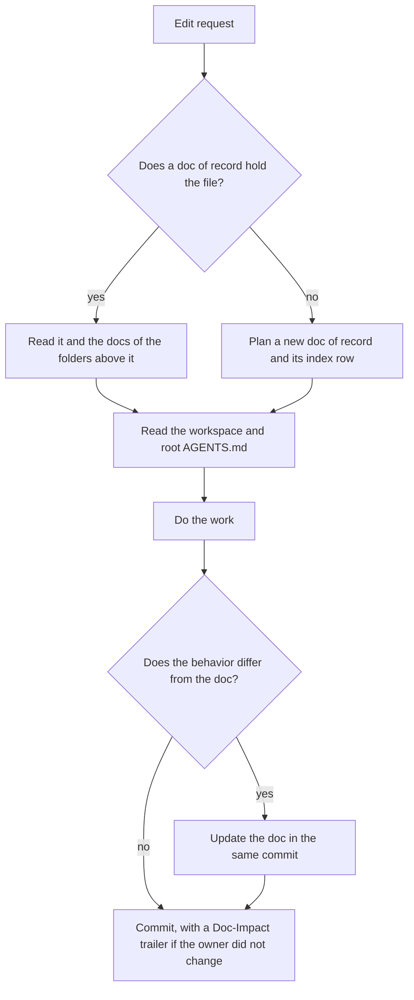

# Doc of record

A doc of record states what one module does now: its goal, constraints, interfaces and invariants. The
code must match it. When the code and the doc disagree, one of them has a bug.

The rule [`.claude/rules/doc-of-record.md`](../.claude/rules/doc-of-record.md) loads these rules when an agent reads a covered file.

## When a module needs one

Write a doc of record when a module has an invariant that the code does not show, and a consumer breaks
when the invariant breaks. A module inside an app usually has one. A package with a public runtime
contract has one. A package that holds only types, presentational components or configuration needs only
its `AGENTS.md`, until an invariant appears.

## Where it lives

- Put the doc in `<workspace>/docs/<module>.md`, in the workspace that holds its code.
- Put the doc in the root `docs/<module>.md` when its code is in no workspace.
- Name the file in kebab-case after the module folder. For example, the folder `src/modules/checks/routes`
  gives `checks-routes.md`.
- List every doc of record in the `README.md` of its `docs/` folder. That file is the index. The nearest
  `AGENTS.md` links the index once, so it stays short however many modules the workspace has.

## Shape

Every doc of record starts with frontmatter:

```yaml
---
id: billing.invoices
code: apps/billing/src/modules/invoices
critical:
  - V1
---
```

- **`id`** is lowercase, with dots or dashes. It is unique in the repository. It never changes, because
  tests cite it.
- **`code`** is the one folder that the doc owns, relative to the repository root. The doc owns every file
  in that folder and below it, except the files of a folder inside it that another doc names. One folder
  has one doc. When the code moves, the `code:` line moves with it in the same commit.
- **`critical`** is optional. List an invariant there only when a test proves the whole invariant.

The headings come in this order. Every doc of record has the goal, and the others are optional.

| Heading | Content |
|---|---|
| `## Goal` | One sentence: why the module exists. |
| `## Constraints` | Bullets: stack, deployment, compatibility and hard limits. |
| `## Interfaces` | The surfaces a reader cannot get from the source, one line each, in a code block. |
| `## Invariants` | Numbered conditions that always hold. |

A repository that declares its own encoding for module docs in `docs/map.md` keeps its own headings. The
frontmatter, the invariant ids and the evidence stay as this doc says.

Two kinds of fact go in other docs, and the doc of record links them:

- A wire shape goes in an API contract. Examples are an endpoint, an event and a queue message. The contract is
  `docs/<subject>-contract.md`, or `<workspace>/docs/<subject>-contract.md` when one workspace uses it.
- A decision that is hard to reverse goes in an ADR under `docs/adr/`, with the options the team declined.

### Interfaces

```text
api: <METHOD> /path -> <status> <what the caller gets>
cmd: <bin> <args> -> <stdout>
env: <NAME>: <constraint>
```

A function signature or a type is not an interface line. The source declares it, and a copy goes stale.
Write a rule about a function as an invariant.

### Invariants

Start each invariant with its id and a colon: `V1:`. A line without the colon right after the id is not an
invariant, and no test can cite it. Write one rule and its reason in one short sentence each.

```text
V1: Every accepted request returns a correlation id. Support traces a request by this id.
V2: The service rejects a token that expired. The issuer owns the clock skew.
- **V3**: retired.
```

The ids read the same as `V1: ...` and as `- **V1**: ...`. Never renumber an id and never use it again. A
retired invariant keeps its id as the line `- **V<n>**: retired.`. In the same change, remove the retired id
from `critical:` and from every citation.

## Evidence

A test proves an invariant only when its title or a comment next to it cites the invariant:

```text
@invariant <id>:V1
```

The citation must be in a test file: `*.test.*`, `*.spec.*` or a file under `__tests__/`. A critical
invariant needs at least one citation. A test that proves part of an invariant is no evidence. Ask the
owner to split the invariant instead.

A green test proves what the code does. It does not prove that the doc states the intended behavior.
Compare the doc, the test and the code when they disagree.

## Rules

1. **Read before you edit.** Before you edit a file, read the doc of record whose `code:` folder holds it.
   Also read each doc of a folder above it, up to the module root. A parent doc holds the rules that span
   its folders. Then read the workspace `AGENTS.md` and the root `AGENTS.md`. If no doc holds the file, start
   with the workspace `AGENTS.md`.
2. **Trust the doc.** When the doc answers the question, do not read the implementation, except to check
   one line. If the doc is wrong, fix the doc.
3. **Update the doc in the same commit.** A change to behavior, an interface or an invariant updates the
   doc of record in the same commit. A fix for a bug against an invariant adds a regression test that
   cites the invariant.
4. **Write a missing doc.** Before non-trivial work in a module that no doc holds, write its doc of record
   and its index row. Take the invariants from the owner's intent. Do not guess them from the code.
5. **Check every module you touch.** A change across several modules reads each affected doc. Then it
   checks that their links and citations still hold.
6. **Move the owner with the code.** The owner of a runtime file is the doc of record with the longest
   `code:` folder that holds it, else the workspace `AGENTS.md`. Tests, type declarations and files under
   `docs/` are not runtime files. A commit that changes a runtime file also changes its owner. When it
   cannot, add the trailer `Doc-Impact: none - <reason>` and name each file and why its behavior cannot
   change.
7. **Cite only a whole proof.** Mark an invariant `critical:` only when a test proves all of it. Never mark
   an invariant critical to look thorough.
8. **State the current code only.** Write no dates and no "was X until". Write no measurements that only
   justify a past change, no verification logs, no task lists and no open check boxes. Put open work and bugs in the
   issue tracker. Git keeps the history.

The gates check the shape of these docs, not their meaning: a doc that states the wrong behavior passes
them. What each gate checks is in the header comment of `scripts/check-docs.mjs` and
`scripts/check-sdd.mjs`, and each failure line says how to fix it. When a gate fails, write the missing doc.
Never delete the link or the check. A change to one coding agent's files follows
[agent parity](agent-parity.md).



## Why

A doc of record puts hundreds of lines of code into a short contract, so the next investigation stays fast
and correct. When an agent skips the doc, it reads the code again and can break an invariant that the code
does not show.
