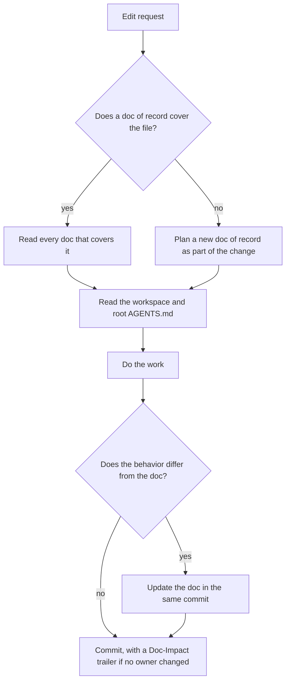

# Doc of record

A doc of record states what one module does now: its goal, constraints, interfaces and invariants. The
code must match it. When the code and the doc disagree, one of them has a bug.

The rule [`.claude/rules/doc-of-record.md`](../.claude/rules/doc-of-record.md) loads these rules when an agent reads a covered file.

## When a module needs one

Write a doc of record when a module has an invariant that the code does not show, and a consumer breaks
when the invariant breaks. A module inside an app usually has one. A package with a public runtime
contract has one. A package that holds only types, presentational components or configuration needs only
its `AGENTS.md`, until an invariant appears.

## Where it lives

- Put the doc in `<workspace>/docs/<module>.md` when every `covers:` glob is inside that workspace.
- Put the doc in the root `docs/<module>.md` when its globs span workspaces.
- Use a kebab-case file name.
- Link each doc of record from the nearest `AGENTS.md` above its `docs/` folder.

## Shape

Every doc of record starts with frontmatter:

```yaml
---
id: billing.invoices
covers:
  - 'apps/billing/src/modules/invoices/**'
critical:
  - V1
---
```

- **`id`** is lowercase, with dots or dashes. It is unique in the repository. It never changes, because
  tests cite it.
- **`covers`** lists globs relative to the repository root. Each glob must match at least one tracked
  file. Several docs can cover one file, for example a parent doc and one doc per folder. Each of them
  owns the file.
- **`critical`** is optional. List an invariant there only when a test proves the whole invariant.

The headings come in this order. Only the goal is required.

| Heading | Content |
|---|---|
| `## Goal` | One sentence: why the module exists. |
| `## Constraints` | Bullets: stack, deployment, compatibility and hard limits. |
| `## Interfaces` | The in-process surfaces, one line each, in a code block. |
| `## Invariants` | Numbered conditions that always hold. |

Two kinds of fact go in other docs, and the doc of record links them:

- A wire shape goes in an API contract. Examples are an endpoint, an event and a queue message. The contract is
  `docs/<subject>-contract.md`, or `<workspace>/docs/<subject>-contract.md` when one workspace uses it.
- A decision that is hard to reverse goes in an ADR under `docs/adr/`, with the options the team declined.

### Interfaces

```text
cmd: <bin> <args> -> <stdout>
env: <NAME>: <constraint>
fn:  <name>(<args>) -> <return>
```

### Invariants

Start each invariant with its id and a colon: `V1:`. The gate ignores a line without the colon right after
the id, and then no test can cite it. Write one rule and its reason in one short sentence each.

```text
V1: Every accepted request returns a correlation id. Support traces a request by this id.
V2: The service rejects a token that expired. The issuer owns the clock skew.
- **V3**: retired.
```

The gate reads `V1: ...` and `- **V1**: ...`. Never renumber an id and never use it again. A retired
invariant keeps its id as the line `- **V<n>**: retired.`. In the same change, remove the retired id from
`critical:` and from every citation.

## Evidence

A test proves an invariant only when its title or a comment next to it cites the invariant:

```text
@invariant <id>:V1
```

The citation must be in a test file: `*.test.*`, `*.spec.*` or a file under `__tests__/`. A critical
invariant needs at least one citation. A test that proves part of an invariant is no evidence. Ask the
owner to split the invariant instead.

A green test proves what the code does. It does not prove that the doc states the intended behavior.
Compare the doc, the test and the code when they disagree.

## Rules

1. **Read before you edit.** Before you edit a file, read every doc of record whose `covers:` matches it.
   Then read the workspace `AGENTS.md` and the root `AGENTS.md`. If no doc covers the file, start with the
   workspace `AGENTS.md`.
2. **Trust the doc.** When the doc answers the question, do not read the implementation, except to check
   one line. If the doc is wrong, fix the doc.
3. **Update the doc in the same commit.** A change to behavior, an interface or an invariant updates the
   doc of record in the same commit. A fix for a bug against an invariant adds a regression test that
   cites the invariant.
4. **Write a missing doc.** Before non-trivial work in a module that no doc covers, write its doc of
   record. Take the invariants from the owner's intent. Do not guess them from the code.
5. **Check every module you touch.** A change across several modules reads each affected doc. Then it
   checks that their links and citations still hold.
6. **Move the owner with the code.** The owners of a runtime file are the docs of record whose `covers:`
   matches it. If no doc matches, the owner is the workspace `AGENTS.md`. Tests, type declarations and
   files under `docs/` are not runtime files. A commit that changes a runtime file must also change one of
   its owners. If the commit changes no owner, add this trailer to the commit message:
   `Doc-Impact: none - <at least 8 words that name each file and say why behavior cannot change>`.
7. **Cite only a whole proof.** Mark an invariant `critical:` only when a test proves all of it. Never
   mark an invariant critical to look thorough, because the gate then fails.
8. **State the current code only.** Write no dates, no "was X until", no measurements that only justify a
   past change, no verification logs and no task lists. Put open work and bugs in the issue tracker. Git
   keeps the history.

The commit-msg hook rejects a commit that breaks rule 6. CI checks each new commit again. The gate also
accepts the trailer name `Spec-Impact:`, which commits before version 1.0.0 of the gates used. A change to
one coding agent's files follows [agent parity](agent-parity.md).



## What the gates check

Both gates check shape, not meaning. A doc that states the wrong behavior passes them.
`scripts/check-docs.mjs` checks that the docs exist and that other docs link them. `scripts/check-sdd.mjs`
checks the frontmatter, the citations and each commit. Each failure line says what is wrong and how to fix
it. When a gate fails, write the missing doc. Never delete the link or the check.

## Why

A doc of record puts hundreds of lines of code into a short contract, so the next investigation stays fast
and correct. When an agent skips the doc, it reads the code again and can break an invariant that the code
does not show.
